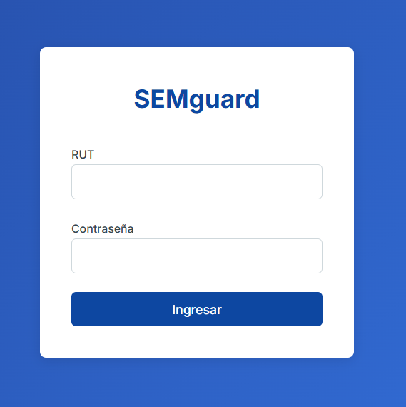
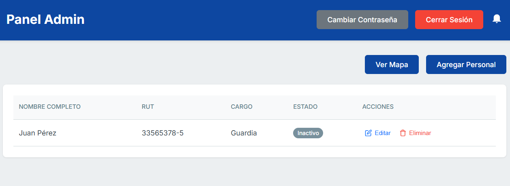
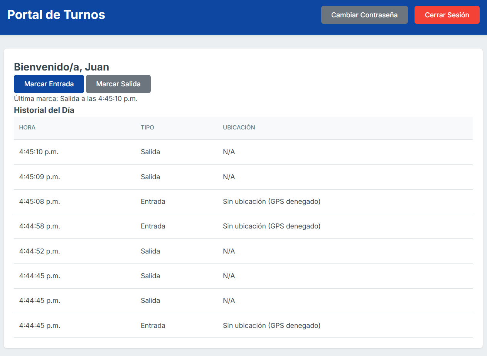

# SEMguard – Gestión de turnos de guardias de seguridad

Aplicación web (SPA) para administrar las horas de trabajo del personal de seguridad de una pyme: los **guardias** registran su entrada y salida con geolocalización y los **administradores** supervisan al personal en tiempo real.

> Proyecto grupal. Todos los datos de la demo son ficticios.

**Demo en línea:** https://proyectoarqui-dffa4.web.app/





## Usuarios de prueba

Para probar la demo sin registrarte, usa estas credenciales **ficticias**:

| Rol | RUT | Contraseña |
|---|---|---|
| Administrador | `admin` | `Admin12` |
| Guardia | `33565378-5` | `4661` |


## Funcionalidades

### Panel de administrador
- Inicio de sesión con RUT y contraseña.
- Tabla responsiva con todo el personal y su estado laboral.
- Alta, edición y eliminación de personal (CRUD). Al crear un guardia se genera una contraseña temporal.
- Reseteo de contraseñas con confirmación.
- **Notificaciones en tiempo real** de entradas y salidas, con indicador de no leídas.
- Registros de turno del día.
- **Mapa interactivo** (Leaflet + OpenStreetMap) con la ubicación de los guardias activos.

### Portal del guardia
- Inicio de sesión con RUT y contraseña.
- **Marcar entrada** con captura de la geolocalización del dispositivo (si el GPS se deniega, la entrada se registra igual como "sin ubicación").
- **Marcar salida.**
- Historial de marcas del día.
- Cambio de contraseña con validación (mínimo 6 caracteres, una mayúscula y un número).

## Arquitectura

Arquitectura **Backend as a Service (BaaS)**: la aplicación se conecta directamente a Firebase y no tiene servidor propio.

```
Navegador (SPA: HTML5 + CSS + JavaScript)
        │
        ├── Cloud Firestore ── colecciones: usuarios · personal · registrosDeTurno · notificaciones
        │        └── onSnapshot → actualizaciones en tiempo real
        ├── Leaflet 1.9.4 + OpenStreetMap (mapa)
        └── API de geolocalización del navegador
Firebase Hosting (entrega de la aplicación)
```

| Colección | Contenido |
|---|---|
| `usuarios` | Credenciales de acceso (RUT, contraseña, rol: `admin` o `guard`) |
| `personal` | Datos del personal, estado laboral (`Activo` / `Inactivo`) y última ubicación |
| `registrosDeTurno` | Entradas y salidas, con su ubicación |
| `notificaciones` | Avisos para el administrador, con estado leído/no leído |

### Tecnologías
- **Frontend:** HTML5, CSS3 y JavaScript sin frameworks (*vanilla JS*).
- **Base de datos:** Cloud Firestore (NoSQL), con Firebase JS SDK 8.10.1.
- **Mapa:** Leaflet 1.9.4 con teselas de OpenStreetMap.
- **Hosting:** Firebase Hosting.

## Estructura del código

```
SEMguard-app/
├── public/
│   └── index.html        # Toda la aplicación: vistas (HTML), estilos (CSS) y lógica (JS)
├── firebase.json         # Configuración de Firebase Hosting
└── .firebaserc           # Proyecto de Firebase asociado
```

Dentro de `index.html` el código está organizado en: configuración de Firebase, estado global, autenticación y navegación, validaciones, renderizado de los paneles de administrador y de guardia, funciones CRUD y modales, listeners de eventos y utilidades.

## Cómo ejecutarlo en local

La geolocalización del navegador solo funciona en `localhost` o con HTTPS, así que **no abras `index.html` con doble clic**. Sírvelo con un servidor local:

```bash
git clone https://github.com/Ernesto-Molina/SEMguard-app.git
cd SEMguard-app

# Opción A: Python
python3 -m http.server 8000 --directory public

# Opción B: Node
npx serve public
```

Luego abre **http://localhost:8000** (o la dirección que indique la terminal). Se necesita conexión a internet para conectarse a Firebase.

### Usar tu propio proyecto de Firebase
1. Crea un proyecto en [Firebase](https://console.firebase.google.com/) y activa **Cloud Firestore**.
2. Reemplaza el objeto `firebaseConfig` en `public/index.html` por el de tu proyecto.
3. Crea en Firestore la colección `usuarios` con un documento de rol `admin` (el ID del documento es el RUT) y la colección `personal`.
4. Para publicar: `firebase deploy --only hosting`.

## Limitaciones conocidas y próximos pasos

SEMguard es un prototipo académico. Las mejoras identificadas son:

- **Autenticación:** usa un inicio de sesión propio contra Firestore, adecuado para el prototipo pero no para producción. El siguiente paso es migrar a **Firebase Authentication** y definir **reglas de seguridad de Firestore** por rol.
- **Lógica de negocio:** hoy se ejecuta en el cliente. Las operaciones sensibles deberían pasar a un backend propio.
- **Organización del código:** separar el archivo único en módulos y usar un empaquetador.
- **Pruebas automatizadas** y control de acceso por rol más estricto.

## Equipo

- **Ernesto Molina** – [Diseño del modelo de datos en Firestore, integración con Firebase, lógica de turnos y geolocalización].
- **Diego Espinoza** – [Creacion del HTML, Recopilacion de necesidades del usuario, Frond End].

## Licencia

Proyecto académico, sin licencia de uso comercial definida.
